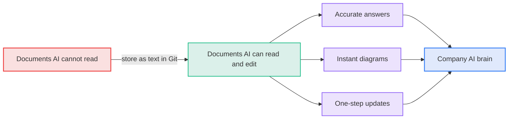
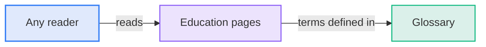
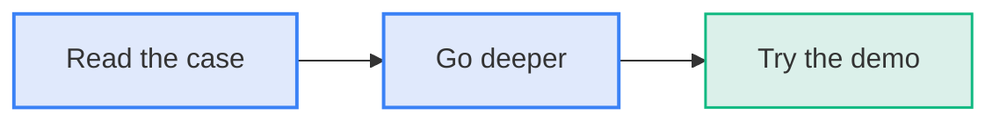
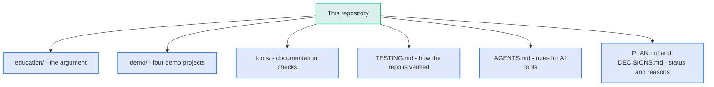
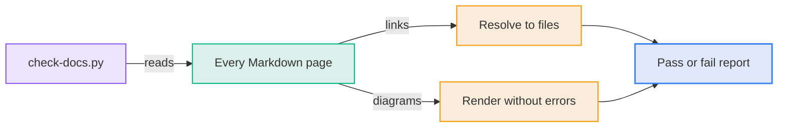

# Documentation as Code

AI is only as useful as what it can read. Most documents live in Word, PowerPoint, and SharePoint, where AI cannot read, edit, or trust them. Store knowledge as text in Git and every team gets accurate answers, instant diagrams, and one-step updates. Do it across an organization and you get an AI brain.

The repository makes that case, gives a crash course you can present, and proves it with demos you can run yourself.

**Diagram: Text in Git turns documents into inputs for the company AI brain**



## Who this is for

The material is for anyone who writes, reads, or relies on documentation, in any team or company. No technical background is needed.

- **Technical terms:**
  - Each term is explained where it appears.
  - The [glossary](education/060-glossary.md) defines every one.

**Diagram: Any reader can read the education pages without technical background because the glossary defines each term**



## Start here

- **Step 1 - read the case:**
  - Open the [eight-minute crash course](education/005-crash-course.md). It is a sequence of diagrams that you can read or present.
- **Step 2 - go deeper:**
  - Open the [education folder](education/README.md) for the full argument.
- **Step 3 - try it:**
  - Clone this repository.
  - Open the folder in your AI tool.
  - Follow a [demo project](demo/README.md) and ask it about a fictional company's documentation.

```bash
git clone <repository-url>
```

**Diagram: A reader moves from the summary to the full argument and then to the demo**



## What is in this repository

**Diagram: The repository is organized into an argument, demos, checks and working files**



| Path                              | Job                                                                                                       | Why it is separate                                                                                     |
| :-------------------------------- | :-------------------------------------------------------------------------------------------------------- | :----------------------------------------------------------------------------------------------------- |
| [education/](education/README.md) | The argument at two lengths: an eight-minute crash course and long-form pages, all diagram-led            | Readers need it in order, without code or demo material in the way                                     |
| [demo/](demo/README.md)           | Four self-contained demo projects, each with documentation, diagrams, a presenter guide, and a reset step | The AI is pointed here to answer questions and make changes live, and a throwaway Git branch resets it |
| [tools/](tools/README.md)         | A script that checks links and that every diagram renders, and tests for that script                      | Keeps the documentation honest, the same way tests keep code honest                                    |
| [AGENTS.md](AGENTS.md)            | Instructions any AI tool reads before working here                                                        | One file keeps behavior consistent across tools                                                        |
| [TESTING.md](TESTING.md)          | The checks that protect each workflow, how to run them, and what they cannot see                          | Tells you what to run after each kind of change                                                        |
| [PLAN.md](PLAN.md)                | Current goal, progress, and the next action                                                               | Lets anyone, or any AI, resume work without asking                                                     |
| [DECISIONS.md](DECISIONS.md)      | Why the repository looks the way it does                                                                  | Prevents re-deciding settled questions                                                                 |

## Verify the documentation

The script confirms that every link resolves and every diagram renders. The repository follows its own rule: documentation is checked like code. [TESTING.md](TESTING.md) says what to run after each kind of change.

```bash
python3 tools/check-docs.py
```

**Diagram: The check script reads every page and reports whether links resolve and diagrams render**


