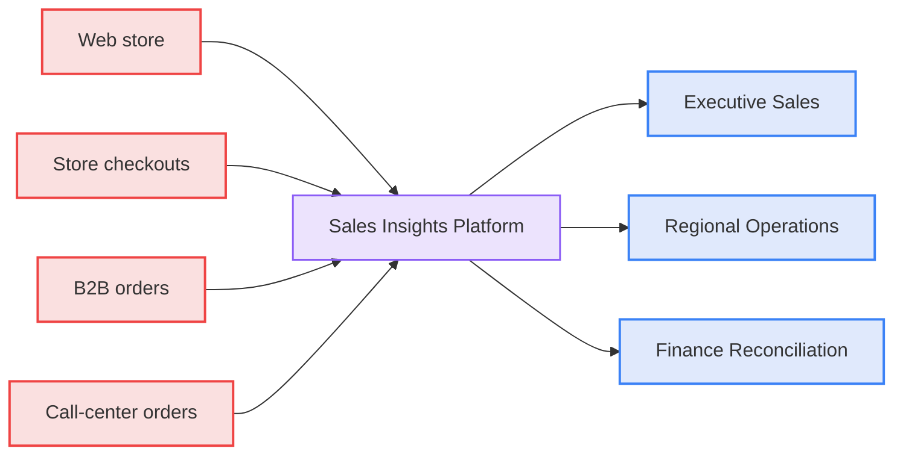
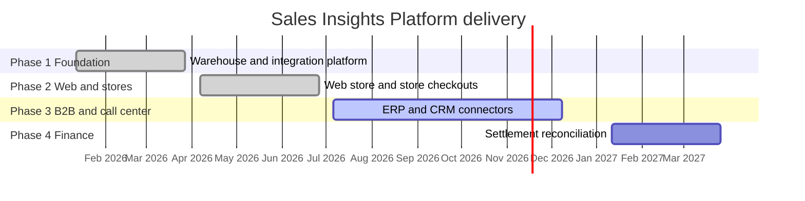

# Sales Insights Platform: Project Overview

The Sales Insights Platform gives Northwind Outfitters one daily view of sales across every channel. It replaces four regional spreadsheets that disagreed with each other.

- **Audience:** Executives, regional managers, finance analysts, and support analysts.
- **Companion documents:**
  - [020 Architecture](020-architecture.md) explains how the platform works.
  - [030 Operations and Decisions](030-operations-and-decisions.md) covers daily running, failures, and the decision log.

## Snapshot

| Item                 | Detail                                                          |
| :------------------- | :-------------------------------------------------------------- |
| Sponsor              | Priya Raman, VP Sales Operations                                |
| Delivery lead        | Marcus Lee, Data Engineering                                    |
| Status               | Phase 3 of 4 in progress, as of 3 November 2026                 |
| Users                | About 340 across executives, regional operations, and finance   |
| Countries            | United States, Canada, United Kingdom, Germany, France, Ireland |
| Hosting              | Cloud A, us-east region, single warehouse                       |
| Integration platform | FlowBridge, contract renews 1 March 2027                        |
| Freshness target     | Dashboards updated by 06:00 US Eastern each day                 |
| Annual run cost      | About $408,000                                                  |

## What the platform covers

**Diagram: Four sales channels feed one platform that serves three dashboards**

### Sales channels

| Channel            | Source system                       | Share of sales | Customers                      | Status                  |
| :----------------- | :---------------------------------- | :------------- | :----------------------------- | :---------------------- |
| Web store          | Web store platform                  | 38%            | Consumers in all six countries | Live since June 2026    |
| Store checkouts    | Point-of-sale systems in 180 stores | 41%            | Consumers and loyalty members  | Live since June 2026    |
| B2B orders         | ERP                                 | 17%            | About 1,200 trade accounts     | Go-live 8 December 2026 |
| Call-center orders | CRM                                 | 4%             | Consumers and trade accounts   | Go-live 8 December 2026 |

Phase 4 adds payment settlement data from the card processor (PayLink, daily) and B2B bank remittances (weekly).

### Store footprint

| Country        | Stores |
| :------------- | :----- |
| United States  | 120    |
| Canada         | 12     |
| United Kingdom | 18     |
| Germany        | 14     |
| France         | 10     |
| Ireland        | 6      |

### Dashboards

| Dashboard              | Audience                               | What it shows                                                                      | Refresh             |
| :--------------------- | :------------------------------------- | :--------------------------------------------------------------------------------- | :------------------ |
| Executive Sales        | Executives                             | Net sales against plan, channel mix, top products                                  | Daily               |
| Regional Operations    | Regional managers and support analysts | Store and web performance, plus an order lookup that shows customer name and email | Daily               |
| Finance Reconciliation | Finance analysts                       | Settlement variance by provider                                                    | Daily, from Phase 4 |

### Measures

- **Net sales:** Sales after discounts and returns.
- **Units sold:** Items sold per channel and product.
- **Average order value:** Net sales divided by orders.
- **Gross margin:** Net sales minus product cost.
- **Return rate:** Returned units divided by units sold.
- **Channel mix:** Each channel's share of net sales.
- **Settlement variance:** Difference between recorded sales and money received (Phase 4).

## Roadmap

**Diagram: Delivery runs in four phases from January 2026 to March 2027**

## Risks

| ID  | Risk                                                        | Impact | Mitigation                                        | Owner       |
| :-- | :---------------------------------------------------------- | :----- | :------------------------------------------------ | :---------- |
| R1  | Duplicate customers across channels distort customer counts | Medium | Match rules in decision ADR-004                   | Marcus Lee  |
| R2  | The FlowBridge renewal on 1 March 2027 falls inside Phase 4 | High   | Start the renewal review by December 2026         | Priya Raman |
| R3  | One engineer knows the ERP connector                        | Medium | Pair a second engineer and document the connector | Marcus Lee  |
| R4  | Dashboard use stays below 60% of target users               | Medium | Run training sessions in each region              | Priya Raman |

## Annual run cost

| Item                                    | Cost per year |
| :-------------------------------------- | :------------ |
| FlowBridge integration platform licence | $180,000      |
| Cloud A warehouse, single region        | $168,000      |
| InsightBoard dashboard licences         | $60,000       |
| **Total**                               | **$408,000**  |

Team salaries are not included.

## Owners

| Role                 | Name           |
| :------------------- | :------------- |
| Sponsor              | Priya Raman    |
| Delivery lead        | Marcus Lee     |
| Finance owner        | Elena Petrova  |
| Security owner       | Tom Okafor     |
| Support lead, Austin | Dana Whitfield |
