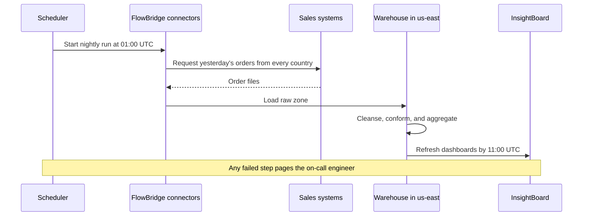
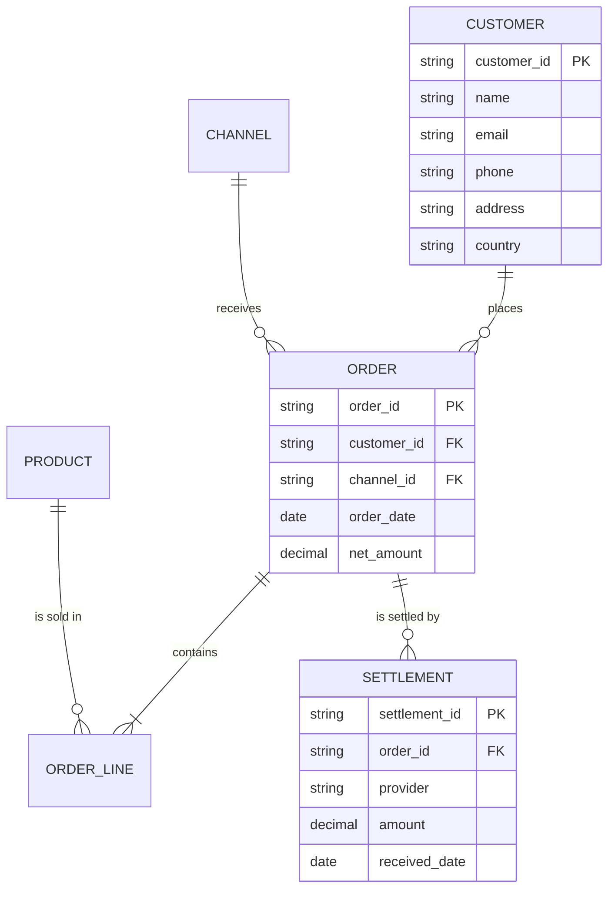

# Sales Insights Platform: Architecture

The platform copies yesterday's orders from each sales system into one warehouse every night. It cleans and combines them, then refreshes the dashboards before the US working day starts.

- **Related documents:**
  - [010 Project Overview](010-project-overview.md) covers scope, status, and cost.
  - [030 Operations and Decisions](030-operations-and-decisions.md) covers running the platform and the decision log.

## Architecture at a glance

**Diagram: Orders flow from the sales systems through FlowBridge into one us-east warehouse and out to dashboards**

```d2
vars: {
  d2-config: {
    layout-engine: tala
    pad: 24
    theme-id: 0
    dark-theme-id: 200
  }
}

direction: right

sources: Sales sources {
  web: Web store platform
  pos: Store checkouts - 180 POS
  erp: B2B orders - ERP
  crm: Call-center CRM
}

settlement: Settlement sources {
  card: PayLink card settlement {
    shape: cloud
    style.stroke-dash: 4
  }
  bank: B2B bank remittances {
    shape: cloud
    style.stroke-dash: 4
  }
}

flowbridge: FlowBridge integration platform - US-East {
  scheduler: Scheduler {shape: queue}
  connectors: Source connectors
  settle_conn: Settlement connectors
}

cloud: Cloud A - us-east region {
  warehouse: Warehouse {
    raw: Raw zone {shape: cylinder}
    staging: Staging zone {shape: cylinder}
    core: Core model {shape: cylinder}
    marts: Sales and finance marts {shape: cylinder}
  }
  snapshots: Daily snapshots {shape: cylinder}
}

backup: Snapshot copy - us-west {shape: cylinder}

dashboards: InsightBoard dashboards {
  exec: Executive Sales
  regional: Regional Operations
  finance: Finance Reconciliation
}

people: Users {
  execs: Executives {shape: person}
  managers: Regional managers {shape: person}
  analysts: Finance analysts {shape: person}
  support: Support analysts - Austin {shape: person}
}

sso: Corporate SSO {
  shape: cloud
  style.stroke-dash: 4
}

sources.web -> flowbridge.connectors: nightly extract
sources.pos -> flowbridge.connectors: nightly extract
sources.erp -> flowbridge.connectors: nightly extract
sources.crm -> flowbridge.connectors: nightly extract
settlement.card -> flowbridge.settle_conn: settlement files
settlement.bank -> flowbridge.settle_conn: remittance files
flowbridge.scheduler -> flowbridge.connectors: 01:00 UTC
flowbridge.connectors -> cloud.warehouse.raw: load
flowbridge.settle_conn -> cloud.warehouse.raw: load
cloud.warehouse.raw -> cloud.warehouse.staging: cleanse
cloud.warehouse.staging -> cloud.warehouse.core: conform
cloud.warehouse.core -> cloud.warehouse.marts: aggregate
cloud.warehouse -> cloud.snapshots: daily snapshot
cloud.snapshots -> backup: replicate
cloud.warehouse.marts -> dashboards.exec: refresh
cloud.warehouse.marts -> dashboards.regional: refresh
cloud.warehouse.marts -> dashboards.finance: refresh
cloud.warehouse.core -> people.support: customer lookup
dashboards.exec -> people.execs: view
dashboards.regional -> people.managers: view
dashboards.finance -> people.analysts: view
sso -> dashboards: sign-in
```

## Components

| Component             | Role                                    | Technology                    | Location                    |
| :-------------------- | :-------------------------------------- | :---------------------------- | :-------------------------- |
| Source connectors     | Pull orders from each sales system      | FlowBridge connectors         | FlowBridge, US-East         |
| Settlement connectors | Pull settlement and remittance files    | FlowBridge connectors         | FlowBridge, US-East         |
| Scheduler             | Starts the nightly run at 01:00 UTC     | FlowBridge scheduler          | FlowBridge, US-East         |
| Warehouse             | Holds raw, staging, core, and mart data | Cloud A warehouse             | us-east                     |
| ETL jobs              | Cleanse, conform, and aggregate data    | SQL jobs inside the warehouse | us-east                     |
| Dashboards            | Present marts to users                  | InsightBoard                  | Vendor cloud, United States |
| Identity              | Signs users in                          | Corporate SSO                 | Corporate                   |
| Alerting              | Pages the on-call engineer              | Paging service                | Corporate                   |

## Nightly load

Every sales system sends its previous day of orders, whichever country the order came from. The platform loads them all into the single warehouse in us-east.

**Diagram: The scheduler starts a nightly chain that ends with refreshed dashboards by 11:00 UTC**



## Data model

The core model holds one record per customer, order, order line, product, channel, and settlement.

**Diagram: A customer's orders each have lines and settlements**



## Security and access

| Role                     | Access                                              | Where                      |
| :----------------------- | :-------------------------------------------------- | :------------------------- |
| Executives               | Executive Sales dashboard                           | InsightBoard               |
| Regional managers        | Regional Operations dashboard                       | InsightBoard               |
| Finance analysts         | Finance Reconciliation dashboard and finance mart   | InsightBoard and warehouse |
| Support analysts, Austin | Read access to the customer table for order lookups | Warehouse, us-east         |
| Data engineers           | All zones                                           | Warehouse, us-east         |

- **Personal data:**
  - The customer table holds name, email, phone, and address.
  - These fields are stored unmasked.
- **Protection:**
  - Data is encrypted at rest and in transit.
  - Users sign in through corporate SSO.

## Availability and recovery

- **Backups:**
  - The warehouse is snapshotted daily.
  - Each snapshot is replicated to a us-west copy.
- **Recovery targets:**
  - Recovery time objective: 8 hours.
  - Recovery point objective: 24 hours.
- **Freshness:**
  - The nightly load finishes between 01:35 and 02:30 UTC, and the load window closes at 05:00 UTC.
  - Dashboards refresh by 11:00 UTC, which is 06:00 US Eastern.

## Volumes

| Measure               | Typical    | Peak                          |
| :-------------------- | :--------- | :---------------------------- |
| Orders per day        | 62,000     | 140,000                       |
| Nightly load duration | 35 minutes | 90 minutes                    |
| Warehouse size        | 4.2 TB     | Growing about 1.1 TB per year |
