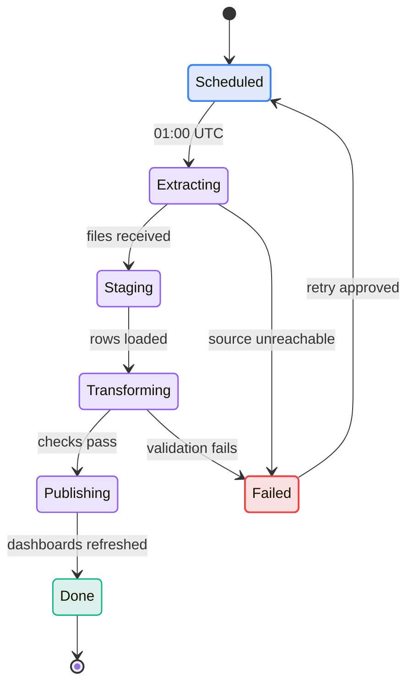
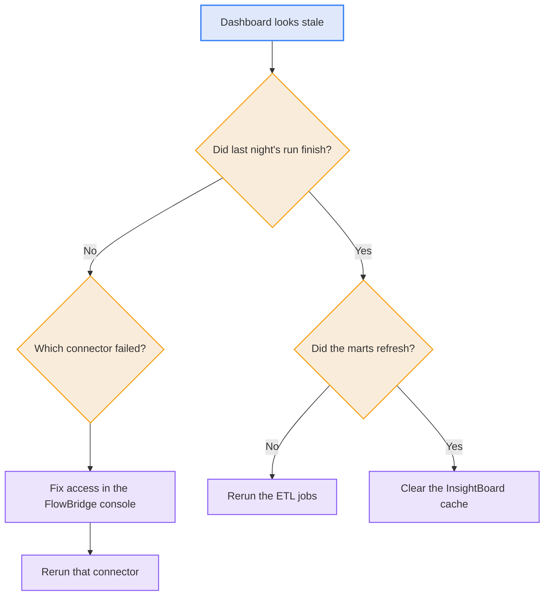

# Sales Insights Platform: Operations and Decisions

This document explains how the platform runs each day, what to do when it fails, and why it was built this way.

- **Related documents:**
  - [010 Project Overview](010-project-overview.md) covers scope, status, and cost.
  - [020 Architecture](020-architecture.md) explains the components.

## Daily operations

| Time (UTC)     | Event                                                  | Owner                    |
| :------------- | :----------------------------------------------------- | :----------------------- |
| 01:00          | Scheduler starts the nightly run                       | FlowBridge scheduler     |
| 01:35 to 02:30 | Load completes, with the window closing at 05:00       | Data engineering on-call |
| 11:00          | Dashboards refreshed                                   | InsightBoard             |
| 13:00          | On-call confirms the morning check in the team channel | Data engineering on-call |

## Load job lifecycle

**Diagram: A nightly load moves through five steps and returns to the schedule after a failure**

## Failure runbook

| Symptom                                                 | Likely cause                  | First action                                                             | Escalate to              |
| :------------------------------------------------------ | :---------------------------- | :----------------------------------------------------------------------- | :----------------------- |
| Web store connector fails                               | Expired credentials           | Rotate the credentials in the FlowBridge console and rerun the connector | Data engineering on-call |
| Store checkout files arrive late                        | Store network or upload delay | Wait until 03:30 UTC, then run a partial load                            | Regional operations      |
| ERP connector times out                                 | ERP maintenance window        | Rerun after 04:00 UTC                                                    | ERP team                 |
| Row counts drop more than 20% against the 7-day average | Partial extract               | Hold publishing and rerun the connector                                  | Data engineering lead    |
| Customer lookup shows the wrong email                   | Duplicate customer match      | Raise a data quality ticket                                              | Support lead, Austin     |

## Triage: the dashboard looks stale

**Diagram: A stale dashboard leads to the failed connector or to a rerun of the mart refresh**

## Disaster recovery

If the us-east region is unavailable, follow these steps. The target is 8 hours.

1. Declare an incident and notify the security owner.
2. Restore the latest snapshot from the us-west copy into a new warehouse.
3. Point InsightBoard at the restored warehouse.
4. Rerun the most recent nightly load.
5. Confirm row counts against the previous day.

## Access requests

- **Process:**
  - Submit the request in the IT portal.
  - The data owner approves it.
- **Support analysts in Austin:**
  - Access to the customer table needs approval from the support lead in Austin.
  - Approval is reviewed every quarter.

## Decision log

### ADR-001: Use FlowBridge as the integration platform

- **Status:** Accepted
- **Date:** 14 November 2025
- **Context:**
  - The project needs prebuilt connectors for point-of-sale, ERP, CRM, and web systems.
- **Chosen:**
  - FlowBridge on a two-year contract ending 1 March 2027.
- **Alternatives:**
  - Custom scripts: rejected because one engineer would hold all the knowledge.
  - Conduit: rejected because it had fewer ERP connectors and a higher price at the time.
- **Revisit when:**
  - The contract renews, or a needed connector is missing.

### ADR-002: Host one warehouse in Cloud A, us-east

- **Status:** Accepted
- **Date:** 21 November 2025
- **Context:**
  - One warehouse gives a single view of all customers and costs less than several.
- **Chosen:**
  - A single warehouse in us-east, with snapshots copied to us-west.
- **Alternatives:**
  - One warehouse per region: rejected because it doubles cost and duplicates the data model.
- **Revisit when:**
  - A legal, regulatory, or contractual requirement for regional hosting appears.

### ADR-003: Load data nightly

- **Status:** Accepted
- **Date:** 2 December 2025
- **Context:**
  - Decision makers review sales the next morning.
- **Chosen:**
  - A nightly batch load starting at 01:00 UTC.
- **Alternatives:**
  - Live streaming: rejected because it adds complexity that next-morning decisions do not need.
- **Revisit when:**
  - The business needs intraday visibility.

### ADR-004: Match customers across channels by email and postcode

- **Status:** Accepted
- **Date:** 9 February 2026
- **Context:**
  - The same person buys in stores and online, and counts must not double.
- **Chosen:**
  - Match on email and postcode, and assign one customer ID.
- **Alternatives:**
  - Loyalty card number only: rejected because most web customers have none.
- **Revisit when:**
  - Duplicate rates stay above 3% for two months.

### ADR-005: Use InsightBoard for dashboards

- **Status:** Accepted
- **Date:** 15 January 2026
- **Context:**
  - Northwind already licenses InsightBoard for other teams.
- **Chosen:**
  - InsightBoard for all three dashboards.
- **Alternatives:**
  - A new dashboard tool: rejected because of licence cost and training time.
- **Revisit when:**
  - InsightBoard cannot support a required measure.

## Contacts

| Need                       | Contact                                   |
| :------------------------- | :---------------------------------------- |
| Platform failures, nightly | Data engineering on-call, Austin rotation |
| Customer lookup questions  | Dana Whitfield, Support lead, Austin      |
| ERP connector issues       | Jordan Ames, ERP team lead                |
| Security incidents         | Tom Okafor, Security owner                |
| Finance questions          | Elena Petrova, Finance owner              |
