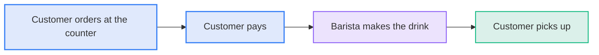

# Coffee Orders: Overview

Coffee orders explains how a customer gets a drink at Bramble Coffee. Every order starts at the counter.

## Snapshot

| Item           | Detail                     |
| :------------- | :------------------------- |
| Owner          | Store manager              |
| Orders per day | About 420                  |
| Average wait   | 4 minutes                  |
| Payment        | Card reader at the counter |

## What a customer experiences

**Diagram: A customer orders at the counter and picks up a drink**

## Risks

| Risk                            | Impact |
| :------------------------------ | :----- |
| Queues at the counter at 8 a.m. | Medium |
| Orders mistyped at the counter  | Low    |
