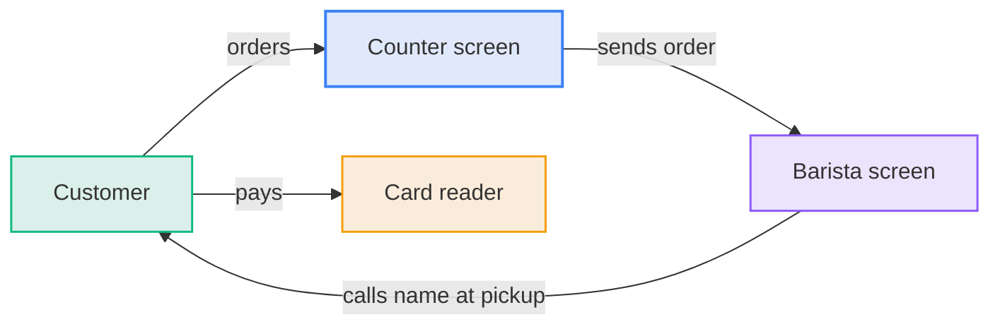

# Coffee Orders: How It Works

The cashier enters the order on the counter screen and takes payment. The order appears on the barista screen, and the barista calls the customer's name at pickup.

## Components

**Diagram: The customer orders at the counter and pays at the card reader, and the barista screen shows the order**

| Component      | Job                                   |
| :------------- | :------------------------------------ |
| Counter screen | Takes the order                       |
| Card reader    | Takes payment                         |
| Barista screen | Shows orders in the order they arrive |

## Rules

- Every order is entered at the counter.
- Orders show on the barista screen in the order they arrive.
