# Crash Course: Documentation as Code in Sixteen Diagrams

Sixteen diagrams, about eight minutes, that take a non-technical audience from "documents are fine as they are" to "documentation should be code" and into a demo. Each diagram answers the question the previous one raises, so you can read the file top to bottom or present it one diagram at a time.

## About the diagram titles

Each diagram carries a `title:` block inside its code, matching the caption above it. A title is shortened only where a long one would be cut off, as in the sequence diagram. A presenter who copies only the diagram into a slide keeps its title. This is a deliberate exception to the usual rule that the caption alone titles a diagram.

## Who this is for

- **Presenters:**
  - Copy each diagram into a slide, or show the file as it is.
  - Preview the diagrams in any previewer that shows Mermaid.
- **Readers with eight minutes:**
  - Read the headings and look at the diagrams. The argument stands without the text.
- **Readers with more time:**
  - Follow the [education folder](README.md). It gives the same argument in depth, and its map shows which section matches each diagram here.

## The objective

- **Goal:**
  - The audience leaves convinced, and ready to see a demo prove the point.
- **The argument in one line:**
  - AI is only as useful as what it can read, and most knowledge sits in Word, PowerPoint, and SharePoint, where AI cannot read, edit, or trust it.
- **Test for every diagram:**
  - A viewer who sees only that diagram understands one new point.
  - No other diagram makes the same point.

## The sequence

| #   | Act           | Message                                                            | The question it answers                    |
| :-- | :------------ | :----------------------------------------------------------------- | :----------------------------------------- |
| 1   | Why now       | Documents now have two readers                                     | Why does this matter today?                |
| 2   | Why now       | Changes to the system never reach Word, PowerPoint, or SharePoint  | What is wrong with how teams work?         |
| 3   | Why now       | AI cannot use those formats                                        | Why does AI make it worse?                 |
| 4   | What it costs | Stale diagrams erode trust until nobody updates anything           | What does it do over time?                 |
| 5   | What it costs | The cost shows up in onboarding, incidents, leadership, and audits | Who feels it?                              |
| 6   | The fix       | AI is only as useful as what it can read                           | What is the insight?                       |
| 7   | The fix       | Documentation as code is three changes: text, diagram recipes, Git | What is it called, and what is it made of? |
| 8   | The fix       | Each format has a text replacement                                 | What does it replace?                      |
| 9   | The fix       | A diagram becomes a recipe that anyone can edit                    | How can a diagram be text?                 |
| 10  | The fix       | Git records, reviews, and undoes every change                      | How do you trust a change?                 |
| 11  | The payoff    | Trust and accuracy reinforce each other                            | What changes?                              |
| 12  | The payoff    | Text in Git gives three capabilities: ask, draw, update            | What can you do with it?                   |
| 13  | The payoff    | One described change reaches every file and waits for approval     | What does update look like?                |
| 14  | The payoff    | Text from every team lets one AI assistant answer from all of it   | Where does this lead?                      |
| 15  | The steps     | Four phases from one pilot to the AI brain                         | What must a team do?                       |
| 16  | The demo      | The demo moves from a question to a rule change to an audit        | What happens next?                         |

## Act 1: Why now

### 1. Documents now have two readers

**Diagram: Documents now have two readers, a person and AI**

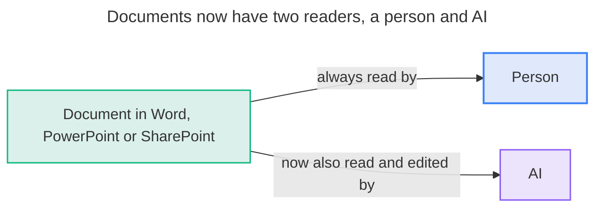

### 2. Changes never reach the documents

**Diagram: A change to the system gives Word, PowerPoint and SharePoint no prompt to update**

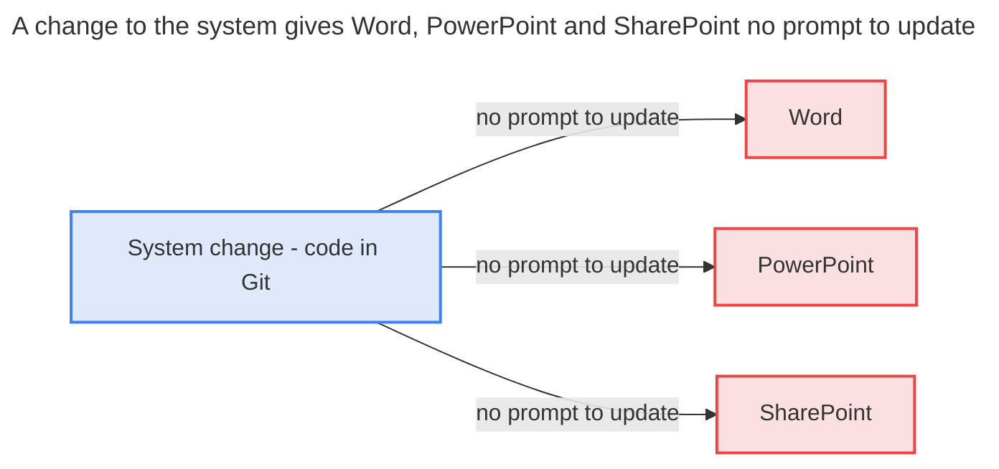

### 3. AI cannot use those formats

**Diagram: Word, PowerPoint and SharePoint each block AI in a different way**

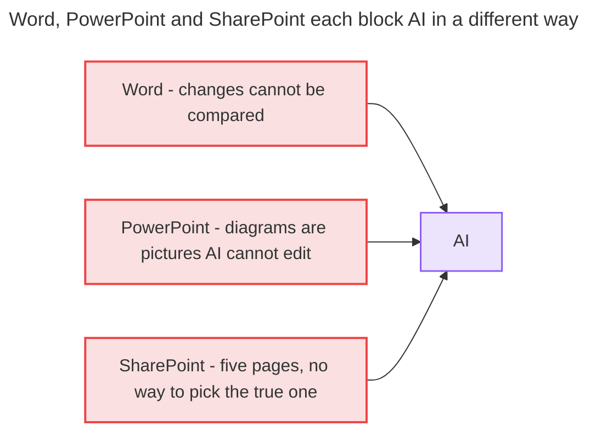

## Act 2: What it costs

### 4. Stale diagrams erode trust

**Diagram: A stale diagram erodes trust until nobody updates the documentation**

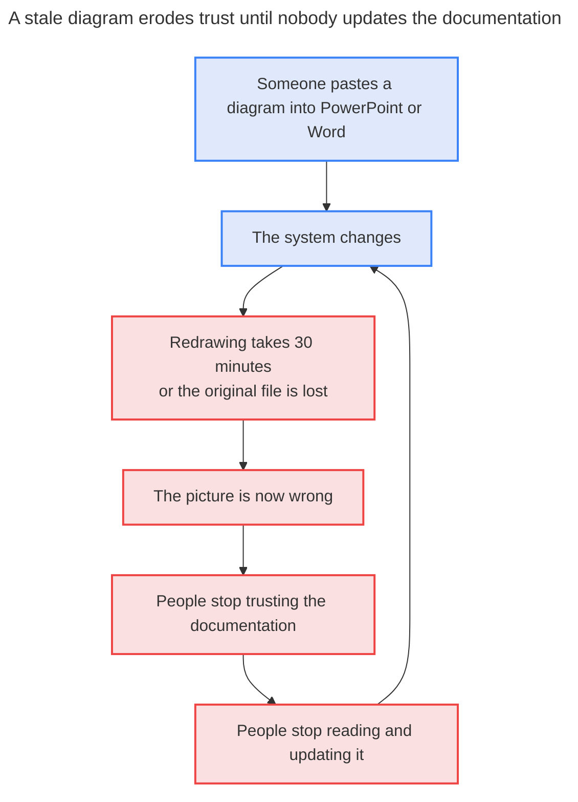

### 5. Who feels the cost

**Diagram: Untrusted Word, PowerPoint and SharePoint documents cost time in four places**

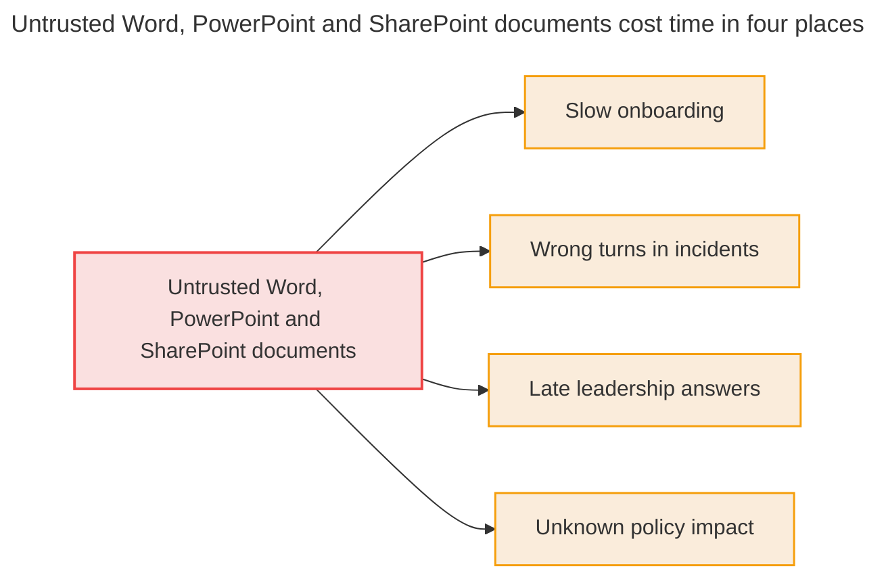

## Act 3: The fix

### 6. The insight

**Diagram: AI is only as useful as what it can read, so knowledge belongs in text in Git**

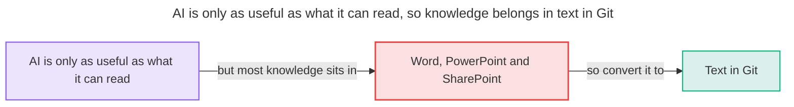

### 7. What it is called

**Diagram: Documentation as code rests on three changes: text, diagram recipes and Git**

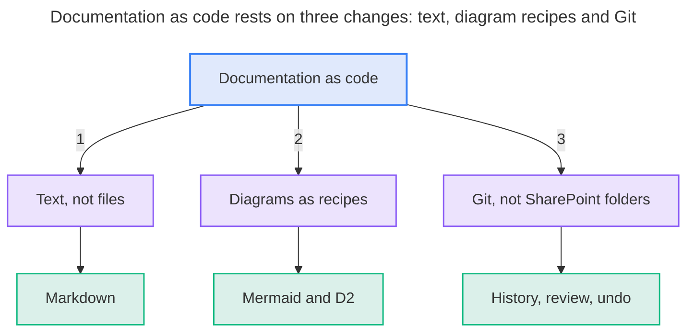

### 8. What it replaces

**Diagram: Each of today's formats is replaced by a text format that AI can use**

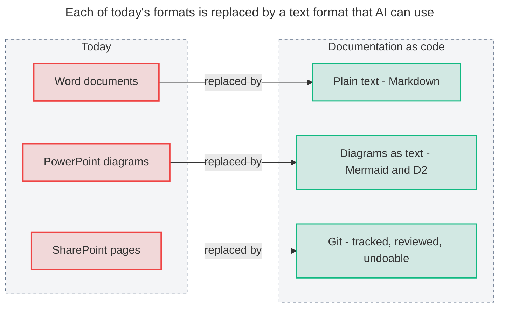

### 9. A diagram becomes a recipe

**Diagram: A diagram recipe is text, so changing one line redraws the diagram**

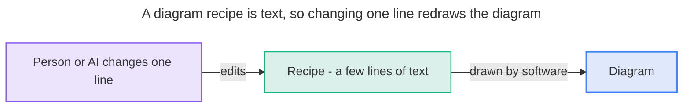

### 10. Git makes change trustworthy

**Diagram: A draft branch merges into the official history only after a reviewer approves**

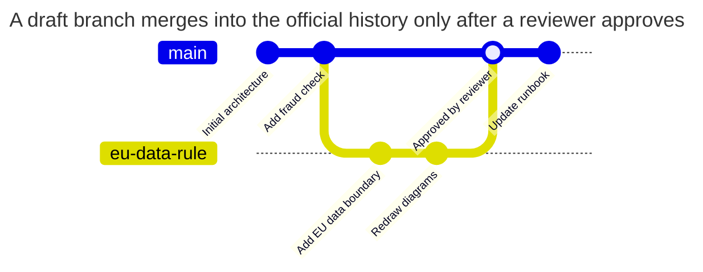

## Act 4: The payoff

### 11. A loop that improves

**Diagram: Up-to-date documents earn trust that surfaces gaps for fixing**

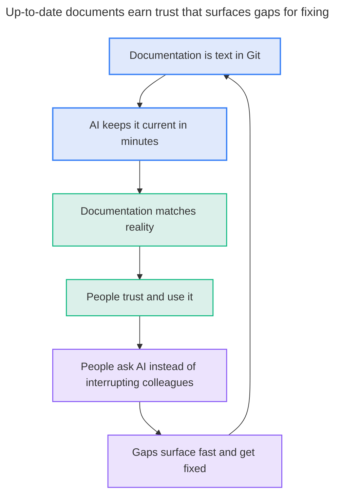

### 12. Three capabilities

**Diagram: Text in Git gives three capabilities: ask, draw and update**

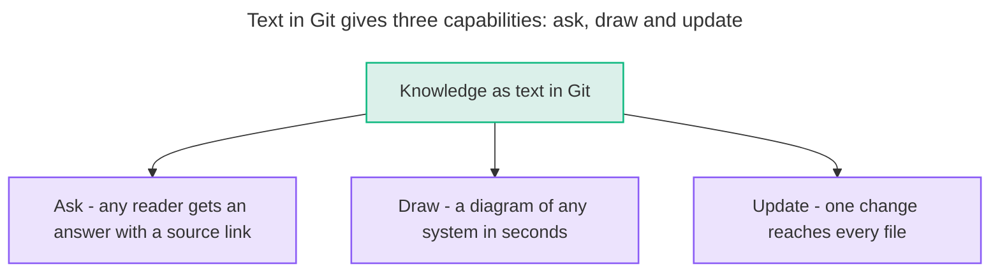

### 13. What update looks like

**Diagram: One described change is applied to every affected file and waits for a person's approval**

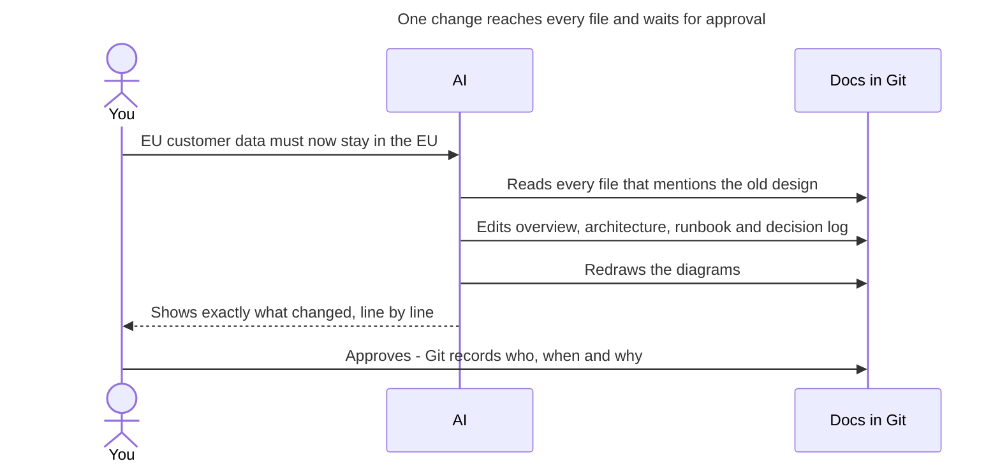

### 14. The company AI brain

The benefit of writing in text is that text is what an AI brain is built from. Any organization that does this can point one assistant at all of it.

**Diagram: Text from every team lets one AI assistant answer each reader from all of it**

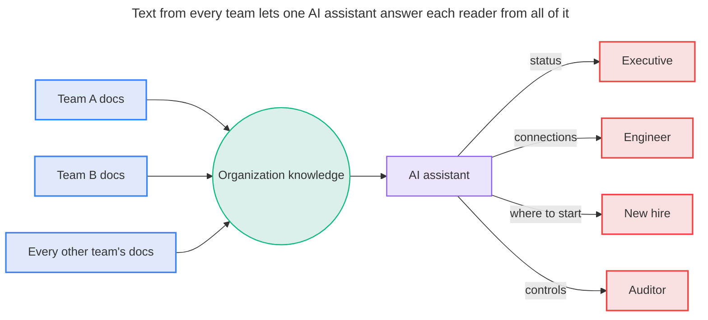

## Act 5: The steps and the demo

### 15. What a team does

Any team or organization that wants to use AI on its own knowledge follows these steps.

**Diagram: Four phases take one pilot project to an organization-wide AI brain**

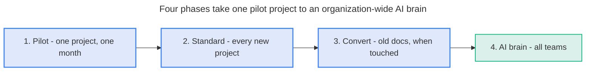

### 16. What happens next

**Diagram: The demo moves from a question to a rule change to an audit**

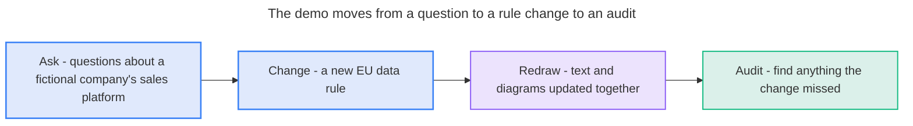

---

**Next:** [010 The Case in Diagrams](010-the-case-in-diagrams.md) · **Index:** [Education](README.md)
