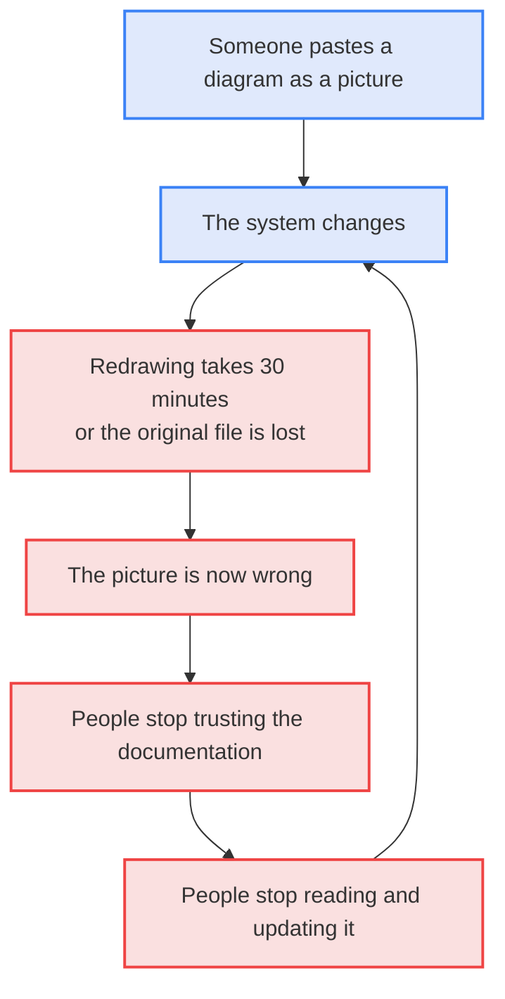
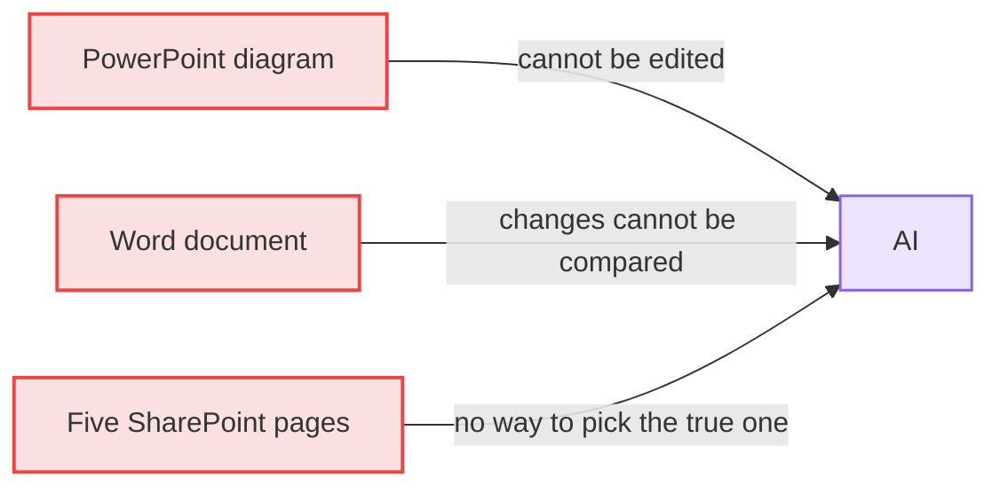
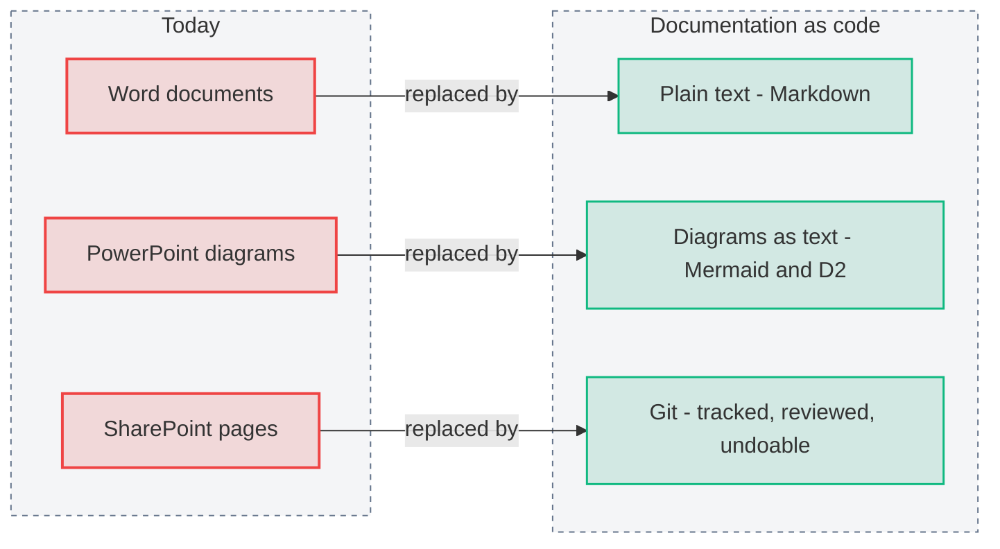
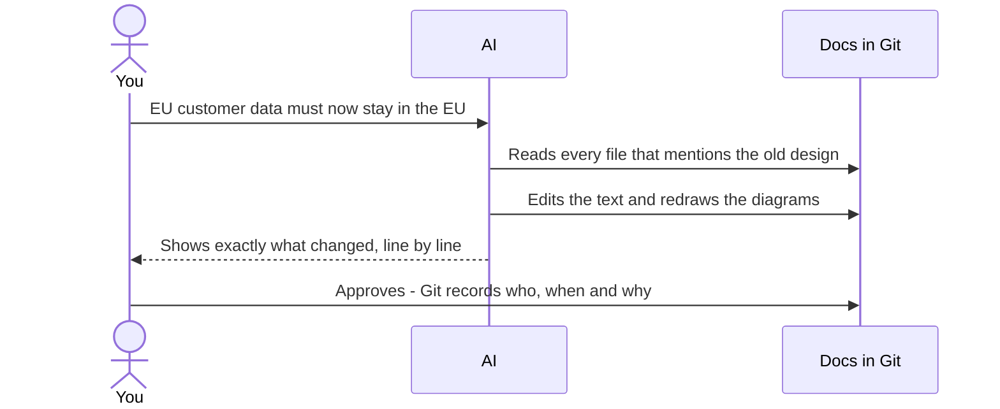
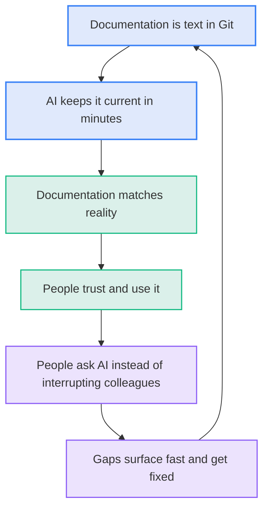
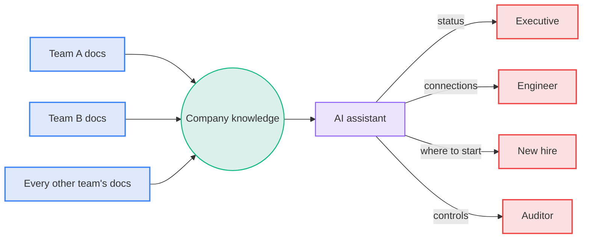

# The Case in Diagrams

**Diagram: The case runs from decaying documents to a company AI brain in six steps**

```mermaid
flowchart LR
    classDef default fill:#64748B1F,stroke:#64748B,stroke-width:1.5px;
    classDef c1 fill:#2563EB24,stroke:#3B82F6,stroke-width:2px;
    classDef c2 fill:#7C3AED24,stroke:#8B5CF6,stroke-width:1.5px;
    classDef c3 fill:#05966924,stroke:#10B981,stroke-width:1.5px;
    classDef c4 fill:#D9770624,stroke:#F59E0B,stroke-width:1.5px;
    classDef c5 fill:#DC262624,stroke:#EF4444,stroke-width:2px;
    s1["1. Documents decay"] --> s2["2. AI cannot help"]
    s2 --> s3["3. Change the format"]
    s3 --> s4["4. One change updates everything"]
    s4 --> s5["5. A loop that improves"]
    s5 --> s6["6. Company AI brain"]
    class s1,s2 c5
    class s3,s4,s5 c1
    class s6 c3
```

Read time: 3 minutes. The whole argument appears as one picture per step. The pages that follow give the detail behind each picture.

---

## The claim

> AI is only as useful as what it can read. Most knowledge sits in files AI cannot read or edit. Move it to text, and the company gets an AI brain.

**Diagram: AI uses only the knowledge it can read, so converting knowledge to text builds the AI brain**

```mermaid
flowchart LR
    classDef default fill:#64748B1F,stroke:#64748B,stroke-width:1.5px;
    classDef c1 fill:#2563EB24,stroke:#3B82F6,stroke-width:2px;
    classDef c2 fill:#7C3AED24,stroke:#8B5CF6,stroke-width:1.5px;
    classDef c3 fill:#05966924,stroke:#10B981,stroke-width:1.5px;
    classDef c4 fill:#D9770624,stroke:#F59E0B,stroke-width:1.5px;
    classDef c5 fill:#DC262624,stroke:#EF4444,stroke-width:2px;
    a["AI reads and edits documents"] -->|"uses only what it can read"| b["Knowledge in files AI cannot read"]
    b -->|"convert to text in Git"| c["Knowledge AI can read and edit"]
    c -->|"repeat in every team"| d["Company AI brain"]
    class a c2
    class b c5
    class c c3
    class d c1
```

---

## Step 1. Today, documentation decays on its own

The format causes the decay. Nobody decides to let documentation rot.

**Diagram: A stale diagram erodes trust until nobody updates the documentation**

---

## Step 2. AI cannot break this loop with today's formats

**Diagram: Each of today's formats blocks AI in a different way**

---

## Step 3. The fix: three changes of format

**Diagram: Each of today's formats is replaced by a text format that AI can use**

---

## Step 4. One change updates everything

**Diagram: One description of a change updates every affected file after a person approves**

---

## Step 5. The result: a loop that improves

**Diagram: Up-to-date documents earn trust that surfaces gaps for fixing**

---

## Step 6. The destination: a company AI brain

Every answer links to its source file, so anyone can check it.

**Diagram: The AI assistant answers each reader from every team's documentation**

---

## The decision

This is the standard to adopt. [The plan](050-adopting-it.md) shows how.

**Diagram: Converting documents to text in stages leads to one AI brain**

---

**Next:** [020 The Problem](020-the-problem.md) · **Index:** [Education](README.md)
