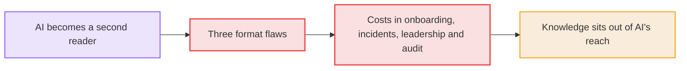
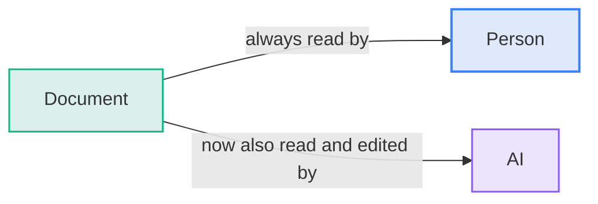
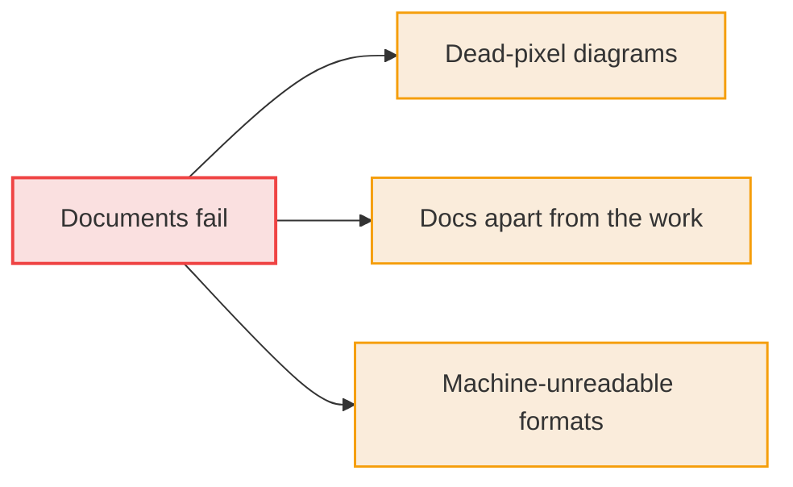
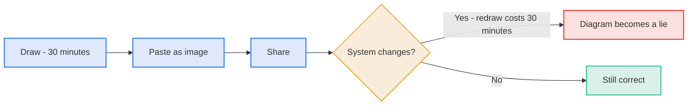
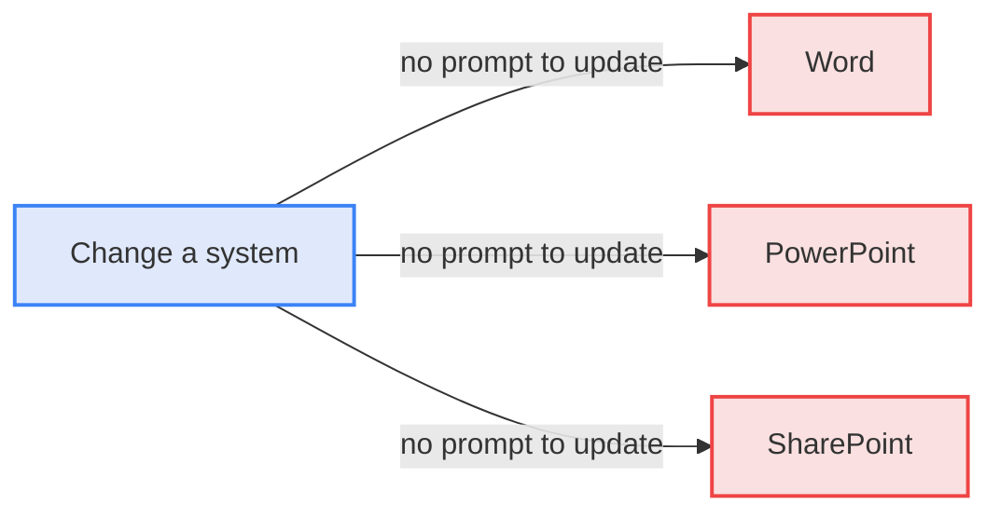
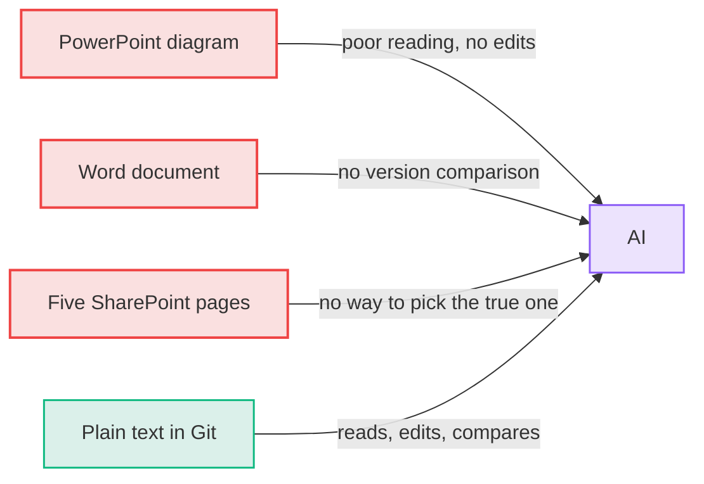
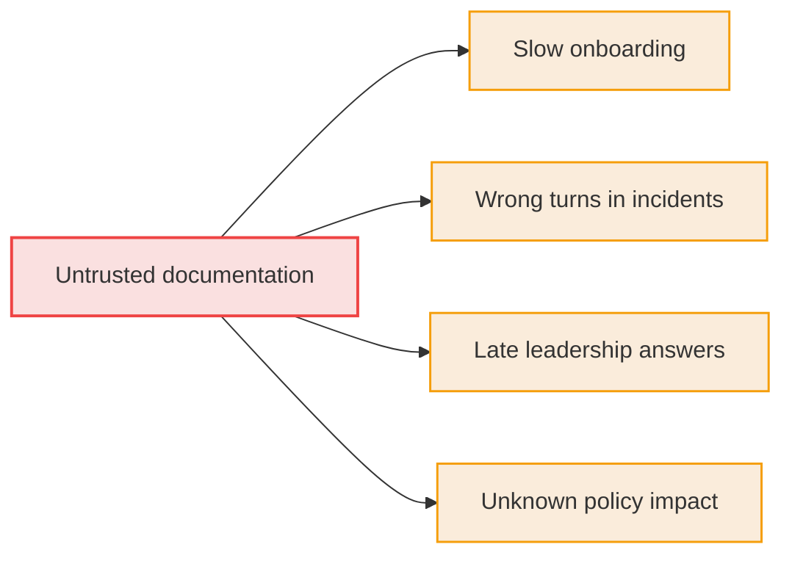

# The Problem: Knowledge Teams Cannot Keep or Use

Documentation fails because the formats make accuracy expensive and AI access impossible. Carelessness plays no part.

**Diagram: Human-only formats cost time and leave knowledge out of AI's reach**



## The shift that changes the standard

Documentation used to have one reader: a person.

- **A person can:**
  - Squint at a screenshot.
  - Guess which of two pages is newer.
  - Ask a colleague what a box on a diagram means.
- **AI is now a second reader:**
  - It reads fast and answers questions from whatever it can access.
  - It also edits: it writes, corrects, and redraws.
  - It works only with material it can read and change.
- **A document now has two jobs:**
  - A person must be able to read it.
  - A machine must be able to read and edit it.
  - Most documents manage only the first job.

**Diagram: A document is read by a person and now also read and edited by AI**



## Three ways documents fail

Each failure comes from a format, not from the people who use it.

**Diagram: Three format flaws make documents fail**



### 1. Images and diagrams are dead pixels

A diagram drawn in PowerPoint and pasted into Word as a PNG is frozen.

- **When a service changes:**
  - The original file is lost, or it lives on someone's laptop.
  - Moving boxes and arrows by hand takes about 30 minutes.
  - No one has a reason to spend those 30 minutes today.
- **The outcome:**
  - The diagram stays and becomes a confident lie.
  - A wrong diagram does more harm than a missing one, because people trust it.

**Diagram: A pasted diagram becomes a lie as soon as the system changes**



### 2. Documents live in a different universe from the work

Code lives in Git. Design and documentation live in Word, PowerPoint, or SharePoint.

- **The gap:**
  - A change to the code has no connection to the page that describes it.
  - Nothing prompts anyone to update the page.
  - Nothing shows that the page is out of date.
- **The effect:**
  - Updating documentation feels like an administrative tax paid after the real work.
  - Under deadline pressure, the tax goes unpaid.

**Diagram: A system change gives the documents no prompt to update**



### 3. Machines cannot read or edit them

AI handles plain text well and every other format poorly.

| Format                             | Can a person use it? | Can AI use it?                               |
| :--------------------------------- | :------------------- | :------------------------------------------- |
| PowerPoint diagram                 | Yes                  | Reads it poorly, **cannot edit it**          |
| Word document                      | Yes                  | Cannot see what changed between versions     |
| Five SharePoint pages on one topic | Yes, with effort     | Cannot tell which page is true               |
| Plain text in Git                  | Yes                  | Reads it fully, edits it, shows every change |

The last row is the only one that works for both readers.

**Diagram: Only plain text in Git lets AI read, edit and compare**



## What this costs

The costs are lost time, not storage.

- **Onboarding:**
  - A new engineer reads documents they cannot trust.
  - The engineer then asks colleagues anyway.
- **Incidents:**
  - During an outage, someone follows an outdated diagram.
  - The diagram points to the wrong system.
- **Leadership questions:**
  - An executive wants the current status.
  - Someone must assemble the status by hand, so the executive waits.
- **Audit and change:**
  - A policy changes.
  - No one knows how many documents mention the old rule.

**Diagram: Untrusted documentation costs time in onboarding, incidents, leadership questions and audits**



## The map of where knowledge sits today

Most knowledge sits in places AI cannot use well. [The solution](030-the-solution.md) moves it to the third group.

**Diagram: AI can edit only the knowledge stored as text in Git**

```d2
vars: {
  d2-config: {
    layout-engine: tala
    pad: 24
    theme-id: 0
    dark-theme-id: 200
  }
}

locked: Locked in files {
  png: PowerPoint diagrams pasted as PNG {shape: document}
  word: Word documents {shape: document}
  slides: PowerPoint decks {shape: document}
}

scattered: Scattered across sites {
  sharepoint: SharePoint sites and pages {shape: document}
  drives: Shared drives {shape: document}
}

ready: Machine-ready {
  markdown: Markdown in Git {shape: document}
  recipes: Diagrams as text {shape: document}
}

ai: AI assistant

locked -> ai: cannot edit
scattered -> ai: cannot pick truth
ready -> ai: reads and edits
```

---

**Previous:** [010 The Case in Diagrams](010-the-case-in-diagrams.md) · **Next:** [030 The Solution](030-the-solution.md) · **Index:** [Education](README.md)
