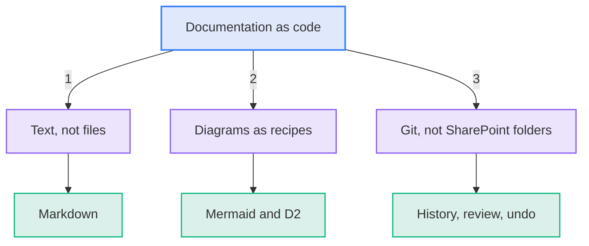
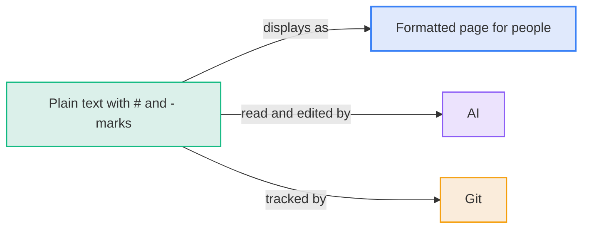
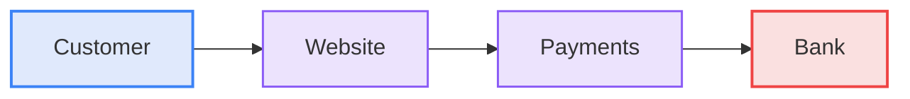
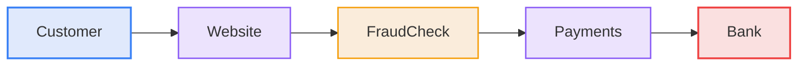
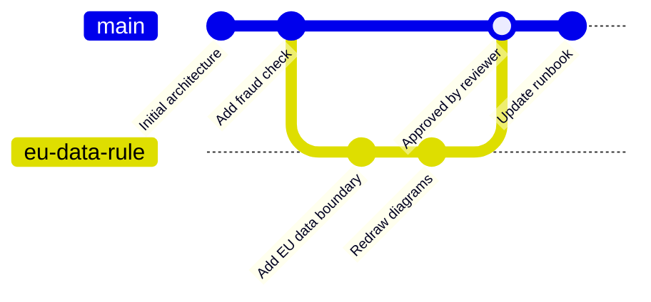
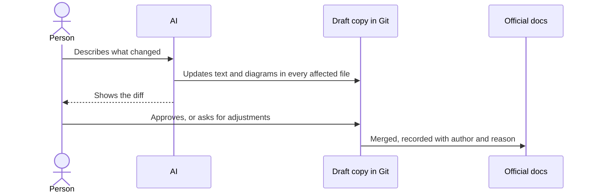
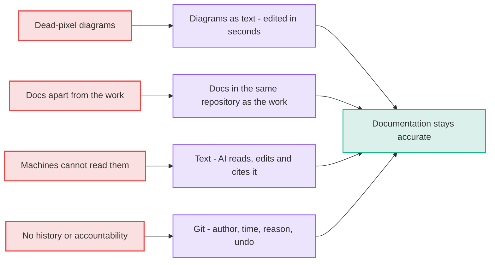

# The Solution: Documentation as Code

Documentation as code means writing documentation with the tools and habits software teams use for code. Three changes do the work.

**Diagram: Documentation as code rests on three changes: text, diagram recipes and Git**



## 1. Text, not files

**Markdown** is plain text with light marks for structure. A `#` makes a heading and a `-` makes a bullet. Displayed, it looks like any formatted document.

```text
# Payments Platform

## Status
- Launch: **on track** for March
- Top risk: partner onboarding delays
```

- **Why text:**
  - Software engineers, version control, and AI all handle plain text natively.
  - No other format works for all three without conversion.
- **What you need to do:**
  - Read the formatted result.
  - Ask the AI to write or change the text.
  - Skip learning Markdown syntax.

**Diagram: Plain text serves people, AI and Git at once**



## 2. Diagrams as recipes, not pictures

**Mermaid** and **D2** turn a few lines of text into a diagram.

- **Analogy:**
  - A photo of a whiteboard cannot be edited.
  - A recipe can: change "2 eggs" to "3 eggs" and the dish changes.
  - A diagram recipe works the same way: add one line and a new box and arrow appear.

The recipe for a small diagram follows. Styling lines are left out.

```text
flowchart LR
    Customer --> Website --> Payments --> Bank
```

**Diagram: A one-line recipe is drawn by software into this diagram**



To add a fraud check between Website and Payments, add one word to the recipe. A person can do it. AI can do it in seconds.

**Diagram: Adding one word to the recipe adds a fraud check between Website and Payments**



- **Which tool when:**
  - Mermaid draws flows, sequences, timelines, and state diagrams. Most code platforms show it automatically.
  - D2 suits large architecture diagrams with many nested parts. It gives finer control over layout.

## 3. Git, not SharePoint folders

**Git** stores every version of every file, with who changed it, when, and why.

- **Analogy:**
  - Track Changes in Word, applied to the whole project, forever.
  - Each change carries an explanation and a one-click undo.

| Term           | Meaning                                                   |
| :------------- | :-------------------------------------------------------- |
| **Repository** | A project folder that Git keeps history for               |
| **Commit**     | One saved change, with a note explaining it               |
| **Diff**       | A side-by-side view of what a change added and removed    |
| **Review**     | A person checks the diff and approves it before it counts |

**Diagram: A draft branch merges into the official history only after a reviewer approves**



- **How to read the picture:**
  - Each dot is a saved change.
  - The branch is a draft that nobody sees until a reviewer approves it.
  - Review is how you see exactly what an AI changed before it becomes the truth.

## How a change moves through the system

A person decides. The AI does the typing.

**Diagram: The AI drafts a change and a person approves it before it becomes official**



## Why each change fixes a failure from before

Every failure named in [the problem](020-the-problem.md) has a matching fix.

**Diagram: Each failure has a matching fix that keeps documentation accurate**



---

**Previous:** [020 The Problem](020-the-problem.md) · **Next:** [040 The Payoff](040-the-payoff.md) · **Index:** [Education](README.md)
