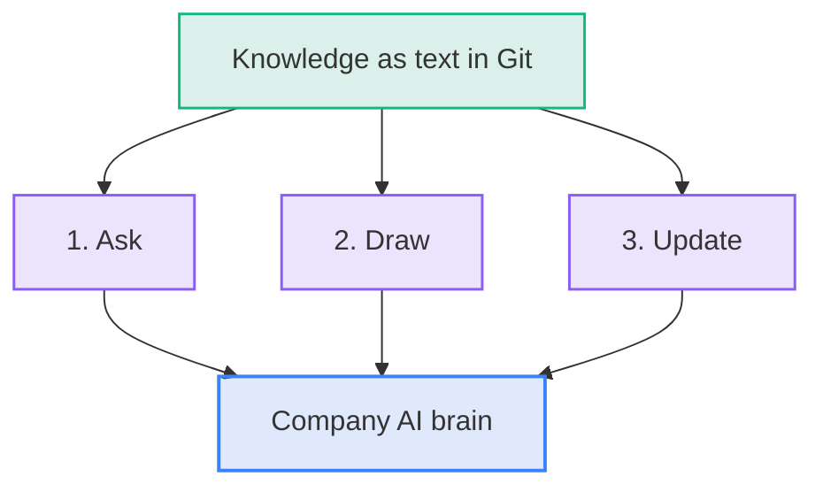
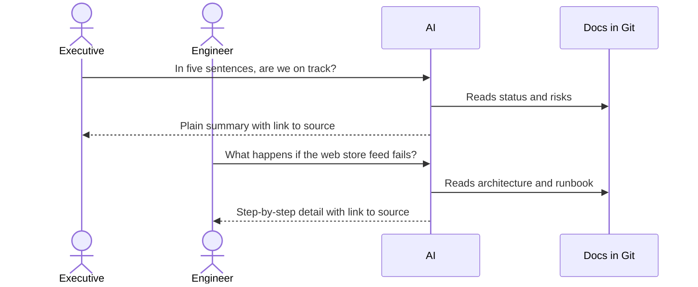
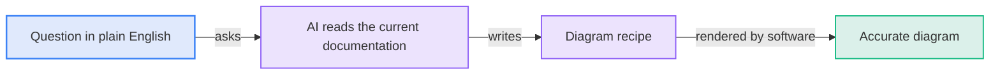
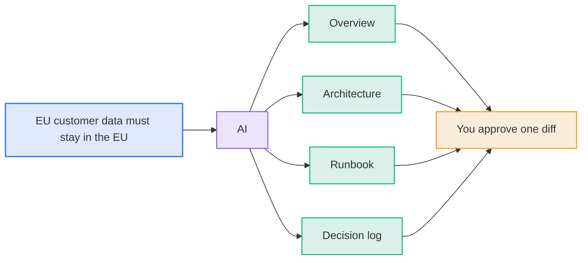
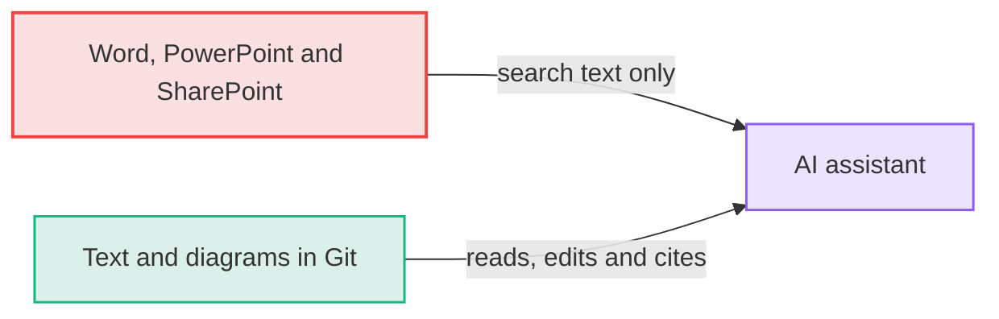

# The Payoff: Three Capabilities and One Company Brain

Knowledge stored as text in Git gives you three capabilities at once. Together they lead to something larger.

**Diagram: Ask, draw and update together form the company AI brain**



## 1. Ask: the right answer for the right reader

Anyone, from a new engineer to an executive, asks the AI how a system works.

- **What the AI does:**
  - Reads the current files.
  - Answers at the level of the person asking.
  - Names the file it used.
- **Why you can trust the answer:**
  - Anyone can open the named file and verify the answer.
  - One source of truth serves every reader.
  - No one writes a separate executive summary that goes stale.

**Diagram: One source of truth answers an executive and an engineer at their own levels**



## 2. Draw: a diagram for any audience in seconds

You do not need a designer to explain a system to an executive. Ask the AI:

> "Draw a diagram of how sales from each channel reach the dashboards, using five boxes at most."

The diagram is accurate because the AI draws it from the current text, not from memory.

**Diagram: A plain-English question becomes an accurate diagram in seconds**



## 3. Update: one change flows everywhere

The old way is to search a dozen files and guess which ones mention a change. The new way is to tell the AI what changed.

- **What the AI updates:**
  - The overview: timeline and benefits.
  - The architecture: text and diagrams.
  - The runbook: failure steps.
  - The decision log: a new entry.
- **What you do:**
  - Review one diff.
  - Approve it.
- **What does not change:**
  - Drift does not disappear on its own.
  - It becomes a five-minute fix instead of a project nobody schedules.

**Diagram: One described change updates four files for a single approval**



## The company AI brain

Each capability works on one repository today. The same capabilities work across the company when every team stores knowledge the same way.

**Diagram: Every team's documentation feeds one index that the AI uses to answer each reader with a source link**

```d2
vars: {
  d2-config: {
    layout-engine: tala
    pad: 24
    theme-id: 0
    dark-theme-id: 200
  }
}

teams: Team repositories {
  finance: Finance docs {shape: document}
  platform: Platform docs {shape: document}
  data: Data and integration docs {shape: document}
  product: Product docs {shape: document}
  policy: Policy and process docs {shape: document}
}

index: Company knowledge index {shape: cylinder}

ai: AI assistant

people: Who asks {
  exec: Executives {shape: person}
  eng: Engineers {shape: person}
  newhire: New joiners {shape: person}
  audit: Auditors {shape: person}
}

teams -> index: feed
index -> ai: exact passages
ai -> people: answer and source link
```

- **Three properties make the brain work:**
  - Every repository uses the same format: text, with diagrams as text.
  - Each fact has one home, and other files link to it.
  - Access follows the repository, so people see answers drawn only from what they may read.

| Situation               | With the brain                                                                          |
| :---------------------- | :-------------------------------------------------------------------------------------- |
| A new hire's first week | Asks where to start and gets a path through current docs                                |
| An incident at 2 a.m.   | On-call asks what depends on the failing service and gets the current diagram           |
| An executive briefing   | A status summary drawn from live project files                                          |
| A regulation changes    | Ask which systems and processes mention it, then update them all in one reviewed change |
| An audit                | Ask for the controls and their history, with sources and change records                 |

## Why this cannot be bolted onto existing documents

An AI added on top of Word, PowerPoint, and SharePoint can search text. It cannot edit diagrams, compare versions, or pick the current page out of five. The brain needs the format change first, so the standard comes before the brain.

**Diagram: AI can do more with text in Git than with Word, PowerPoint and SharePoint**



---

**Previous:** [030 The Solution](030-the-solution.md) · **Next:** [050 Adopting It](050-adopting-it.md) · **Index:** [Education](README.md)
