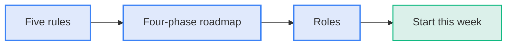
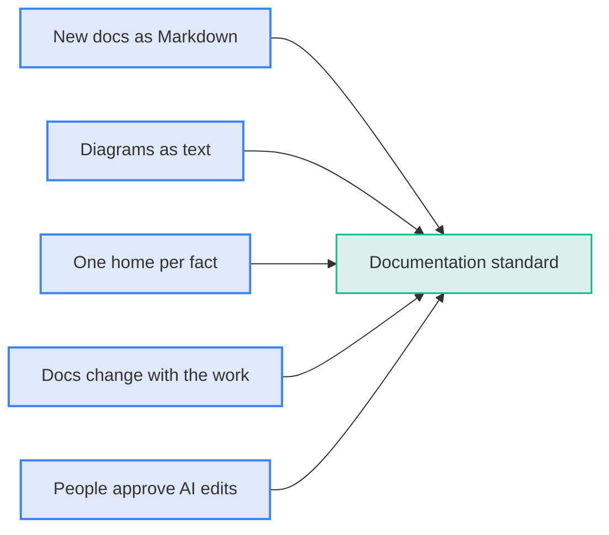
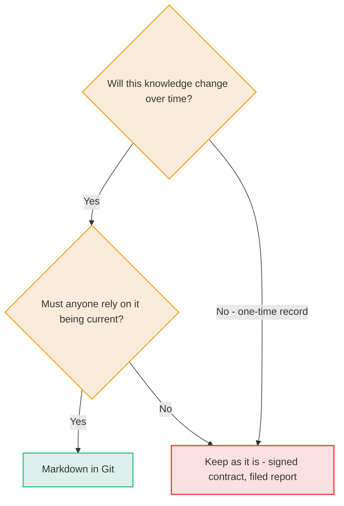
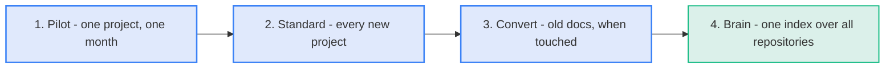
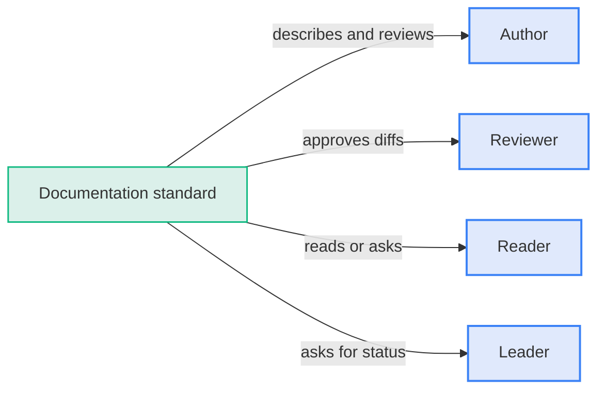
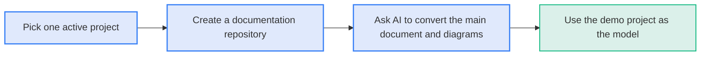

# Adopting It: The New Standard

Adopt documentation as code as the way you document. The steps are small and start today.

**Diagram: Adoption runs from five rules through a four-phase roadmap to defined roles and a first step**

## Five rules

- **Rule 1:**
  - New documentation starts as Markdown in Git.
  - Living knowledge gets no new Word documents.
- **Rule 2:**
  - Diagrams are text.
  - Use Mermaid for flows, sequences, timelines, and states.
  - Use D2 for large architecture.
  - Add no new pasted images of diagrams.
- **Rule 3:**
  - Each fact has one home.
  - State the fact in one file and link to it everywhere else.
- **Rule 4:**
  - Documentation changes with the work.
  - A change to a system includes the change to its documentation, reviewed together.
- **Rule 5:**
  - A person approves every AI edit.
  - The reviewer reads the diff, the same way a code change is reviewed.

**Diagram: Five rules together form the documentation standard**

## What belongs in Git, and what does not

Architecture, decisions, processes, runbooks, policies, project status, and onboarding guides belong in Git. One-time records stay as they are.

**Diagram: Knowledge that changes and that people rely on belongs in Git**

## Roadmap

**Diagram: Four phases take one pilot project to a company-wide AI brain**

| Phase       | What happens                                                                                                      | Done when                                          |
| :---------- | :---------------------------------------------------------------------------------------------------------------- | :------------------------------------------------- |
| 1. Pilot    | One active project moves its docs into a repository. The team asks the AI questions and makes updates through it. | The team prefers it to the old way                 |
| 2. Standard | Every new project starts with a docs repository using the five rules.                                             | New projects have no pasted-image diagrams         |
| 3. Convert  | When someone touches an old document, AI converts it to Markdown and redraws its diagrams as text.                | Active projects are all converted                  |
| 4. Brain    | One index reads all repositories. The company assistant answers from it.                                          | Anyone can ask any team's documentation a question |

## Who does what

**Diagram: Each role does one job under the standard**

| Role         | What changes for them                                                                               |
| :----------- | :-------------------------------------------------------------------------------------------------- |
| **Author**   | Describes content to the AI and reviews the result. No Markdown syntax required.                    |
| **Reviewer** | Reads the before/after diff and approves, the same as reviewing a Word document with Track Changes. |
| **Reader**   | Opens the rendered page or asks the AI.                                                             |
| **Leader**   | Asks the AI for status and gets it from live files.                                                 |

## Start this week

- **Steps:**
  - Pick one active project.
  - Create a repository for its documentation.
  - Ask the AI to convert its main Word document to Markdown and its key diagrams to Mermaid.
  - Use the projects in the [demo folder](../demo/README.md) as the model.

**Diagram: Four steps start a pilot this week**

---

**Previous:** [040 The Payoff](040-the-payoff.md) · **Next:** [060 Glossary](060-glossary.md) · **Index:** [Education](README.md)
