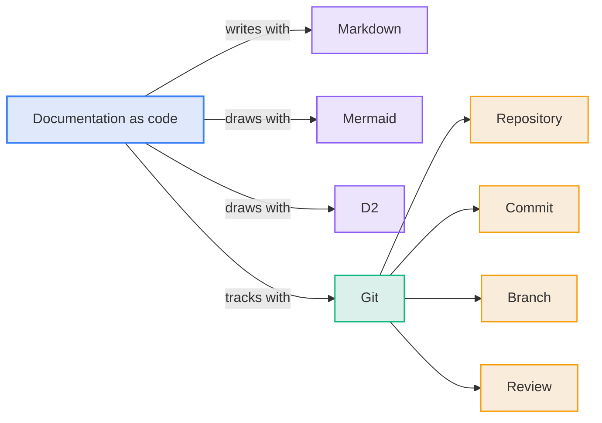

# Glossary

Plain meanings for the terms used in this material.

**Diagram: Documentation as code combines a text format, diagram languages and Git**

| Term                      | What it means                                                                              | Everyday comparison                                        |
| :------------------------ | :----------------------------------------------------------------------------------------- | :--------------------------------------------------------- |
| **Documentation as code** | Writing documentation as text, stored in Git, using the habits software teams use for code | Treating a company handbook like a shared, tracked project |
| **Markdown**              | A way to format plain text with light marks (`#` for a heading, `-` for a bullet)          | Word formatting, written as symbols                        |
| **Mermaid**               | A text language that software turns into diagrams: flows, sequences, timelines             | A recipe for a drawing                                     |
| **D2**                    | Another diagram language, suited to large architecture diagrams                            | A more detailed recipe for bigger drawings                 |
| **Git**                   | A system that stores every version of every file with author, time, and reason             | Track Changes across a whole project                       |
| **Repository**            | A project folder that Git keeps history for                                                | A shared binder with a full change log                     |
| **Commit**                | One saved change with a note explaining it                                                 | A dated entry in the binder's log                          |
| **Branch**                | A draft copy where changes are made without affecting the official version                 | A draft you do not file until it is approved               |
| **Diff**                  | A view of exactly what a change added and removed                                          | The red and green marks in Track Changes                   |
| **Merge**                 | Accepting a branch's changes into the official version                                     | Filing the approved draft                                  |
| **Review**                | A person checks a diff and approves it                                                     | A colleague signing off on edits                           |
| **Render**                | Turning text into the visible result, such as a diagram                                    | Printing the recipe's dish                                 |
| **AI assistant**          | A tool that reads files, answers questions, and makes edits when asked                     | A fast colleague who has read everything                   |
| **Source of truth**       | The one file that holds the official version of a fact                                     | The master copy                                            |

---

**Previous:** [050 Adopting It](050-adopting-it.md) · **Index:** [Education](README.md)
