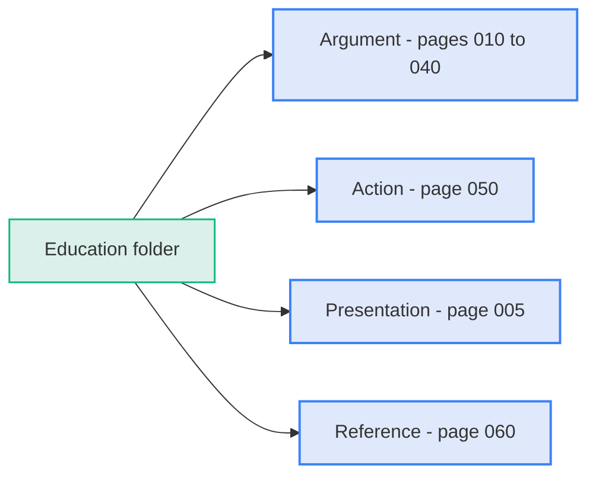
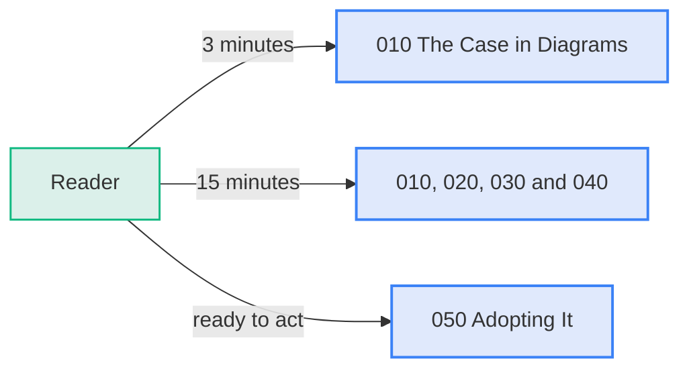
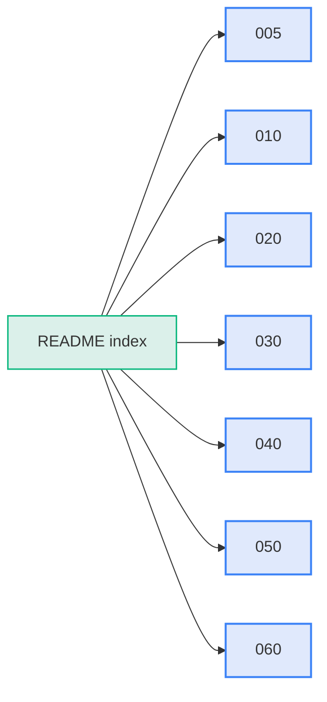
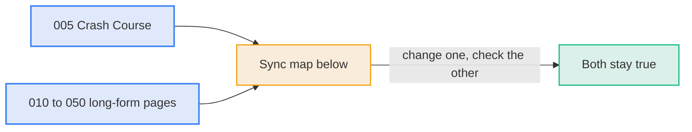
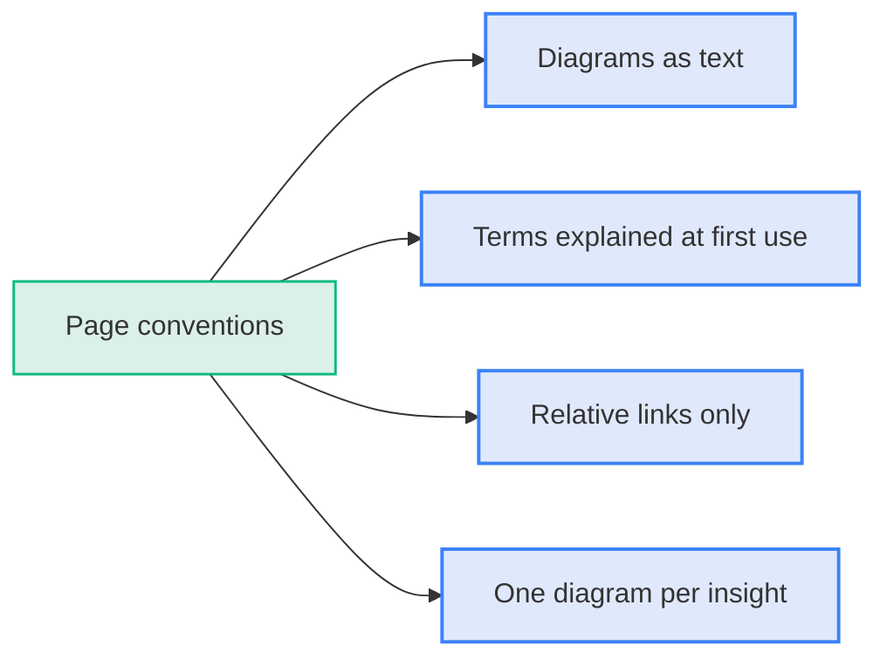

# Education

The folder holds the complete argument for documentation as code, written for a non-technical audience. Every page leads with diagrams, so a reader can follow the argument from the pictures alone and read the text for depth. The crash course gives the argument in eight minutes, and the numbered pages give it in depth.

**Diagram: The education folder takes a reader from the argument to action, with a glossary for reference**

## Start here

Pick the path that fits your time.

**Diagram: The time you have decides which pages to read**

| You have              | Read                                                                                      |
| :-------------------- | :---------------------------------------------------------------------------------------- |
| 8 minutes, to present | [005 Crash Course](005-crash-course.md)                                                   |
| 3 minutes             | [010 The Case in Diagrams](010-the-case-in-diagrams.md)                                   |
| 15 minutes            | 010, then [020](020-the-problem.md), [030](030-the-solution.md), [040](040-the-payoff.md) |
| To act on it          | [050 Adopting It](050-adopting-it.md)                                                     |

## How the pages are laid out

Each page carries one part of the argument. Each part answers the question the previous part raised.

**Diagram: Each page answers the question the previous page raised**

```mermaid
flowchart LR
    classDef default fill:#64748B1F,stroke:#64748B,stroke-width:1.5px;
    classDef c1 fill:#2563EB24,stroke:#3B82F6,stroke-width:2px;
    classDef c2 fill:#7C3AED24,stroke:#8B5CF6,stroke-width:1.5px;
    classDef c3 fill:#05966924,stroke:#10B981,stroke-width:1.5px;
    classDef c4 fill:#D9770624,stroke:#F59E0B,stroke-width:1.5px;
    classDef c5 fill:#DC262624,stroke:#EF4444,stroke-width:2px;
    a["010 The whole case"] --> b["020 Why current docs fail"]
    b --> c["030 What fixes it"]
    c --> d["040 What it unlocks"]
    d --> e["050 What to do next"]
    class a,b,c,d,e c1
```

## Contents

- [005-crash-course.md](005-crash-course.md): Sixteen diagrams in five acts that make the whole case in about eight minutes, for presenting or reading.
- [010-the-case-in-diagrams.md](010-the-case-in-diagrams.md): The whole argument in nine diagrams, readable in three minutes.
- [020-the-problem.md](020-the-problem.md): Why dead-pixel diagrams, separated docs, and machine-opaque formats fail now that AI reads the work.
- [030-the-solution.md](030-the-solution.md): The three changes (text, diagrams as recipes, Git) with analogies and examples.
- [040-the-payoff.md](040-the-payoff.md): Ask, draw, update, and the company AI brain.
- [050-adopting-it.md](050-adopting-it.md): The five rules, a four-phase roadmap, and what to do this week.
- [060-glossary.md](060-glossary.md): Plain-language meanings of every technical term used.
- [images/](images/d2-architecture-example.png): The rendered D2 architecture image shown on crash-course slide 9.

**Diagram: The folder index points to seven pages in reading order**

## Keeping the long and short versions in step

The crash course and the long-form pages make the same argument at two lengths. A change to an idea on one side must reach the other.

**Diagram: A change to a shared idea is made in both the crash course and its long-form twin**

| Crash course diagram                 | Long-form twin                                                                              |
| :----------------------------------- | :------------------------------------------------------------------------------------------ |
| 1. Two readers                       | [020 The shift that changes the standard](020-the-problem.md)                               |
| 2. Changes never reach the documents | [020 Documents live in a different universe from the work](020-the-problem.md)              |
| 3. AI cannot use those formats       | [020 Machines cannot read or edit them](020-the-problem.md)                                 |
| 4. Stale diagrams erode trust        | [010 Step 1](010-the-case-in-diagrams.md)                                                   |
| 5. Who feels the cost                | [020 What this costs](020-the-problem.md)                                                   |
| 6. The insight                       | [010 The claim](010-the-case-in-diagrams.md)                                                |
| 7. What it is called                 | [030 The Solution, introduction](030-the-solution.md)                                       |
| 8. What it replaces                  | [010 Step 3](010-the-case-in-diagrams.md)                                                   |
| 9. A diagram becomes a recipe        | [030 Diagrams as recipes, not pictures](030-the-solution.md)                                |
| 10. Git makes change trustworthy     | [030 Git, not SharePoint folders](030-the-solution.md)                                      |
| 11. A loop that improves             | [010 Step 5](010-the-case-in-diagrams.md)                                                   |
| 12. Three capabilities               | [040 The Payoff, introduction](040-the-payoff.md)                                           |
| 13. What update looks like           | [010 Step 4](010-the-case-in-diagrams.md) and [040 Update](040-the-payoff.md)               |
| 14. The company AI brain             | [010 Step 6](010-the-case-in-diagrams.md) and [040 The company AI brain](040-the-payoff.md) |
| 15. What a team does                 | [050 Roadmap](050-adopting-it.md)                                                           |
| 16. What happens next                | [Demo index](../demo/README.md)                                                             |

- **When you change the argument:**
  - Update the crash-course diagram and its long-form twin in the same change.
  - Add or remove a row in this map when you add or remove a diagram.
  - Run `python3 tools/check-docs.py` to confirm links and diagrams still work.

## Conventions

- **Diagrams:**
  - Mermaid shows flows, sequences, timelines, and states.
  - D2 shows complex architecture.
  - Both live as text in the page. The one image, on crash-course slide 9, is a rendered copy of a D2 diagram, and its text recipe stays the source.
- **Terms:**
  - Every technical term is explained at first use.
  - An analogy accompanies the term where one fits.
- **Links:**
  - Pages link to each other with relative paths.
  - The folder works anywhere it is cloned.

**Diagram: Four conventions keep every page consistent**

**Navigation:** [Repository home](../README.md)
